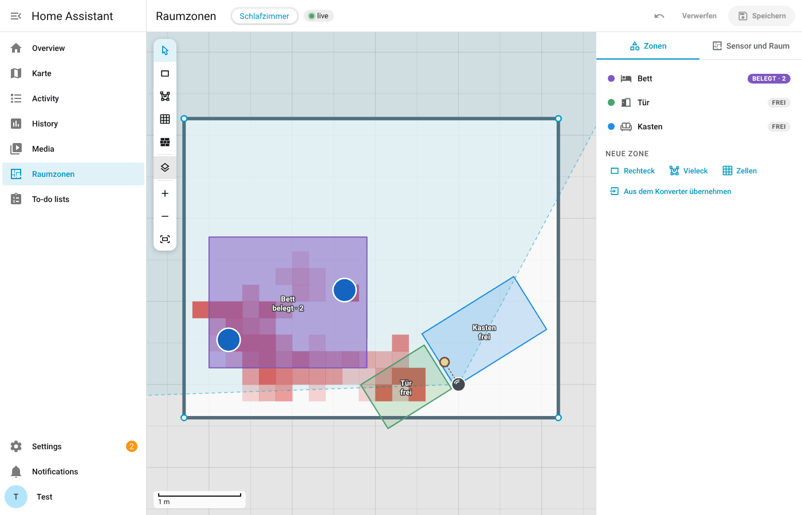

# Raumzonen

Präsenzzonen für Radarsensoren in Home Assistant, zuerst für den
**Aqara FP400** über Zigbee2MQTT.

> **Stand 0.6.0.** Sensor angebunden, Entitäten je Zone, Panel „Raumzonen“
> mit Raumplan zum Zeichnen (Zonen, Wände mit Türen), Figuren live,
> Bewegungskarte und Hausplan; Schnittstelle für andere Integrationen.
> Raumzonen **schaltet nichts**; es meldet nur, wo jemand ist.
> Bedienung: `docs/HANDBUCH.md`.

## Was es werden soll

* Zonen in beliebiger Form: Vieleck, schräges Rechteck oder gemalte Zellen,
  gezeichnet auf einem Raumplan.
* Je Zone sichtbare Regeln statt versteckter Wartezeiten: belegt nach,
  frei nach, Randstreifen, „Schläfer halten“, Hund nicht mitzählen.
* Spuren, die nicht verschwinden: Ein Mensch löst sich nicht in Luft auf,
  nur weil der Sensor kurz nichts meldet.
* Ziel fürs Bett: „aufgestanden“ in höchstens 5 Sekunden, ohne Fehlalarme im
  Schlaf.

## Voraussetzungen

* Home Assistant 2026.10 oder neuer
* Zigbee2MQTT mit dem erweiterten FP400-Konverter, der Positionen liefert
  (`tracking_targets`, `targets_xy`), und mindestens einer Software-Zone im
  Konverter (sonst kommen keine Positionen)

## Installation über den Marketplace

Einstellungen → Marketplace → eigenes Repository hinzufügen
(`Kingsteam/Raumzonen`, Kategorie Integration) → Raumzonen installieren →
Home Assistant neu starten → Einstellungen → Geräte & Dienste → Integration
hinzufügen → „Raumzonen“. Updates erscheinen danach unter
Einstellungen → Updates.

## Entwicklung

Siehe `CLAUDE.md` (Aufbau, Tests, Regeln) und `docs/`.

## Dank und Herkunft

Raumzonen baut auf der Arbeit von **bobtekkk** auf: dem Projekt
[aqara-fp400-zone-card](https://github.com/bobtekkk/aqara-fp400-zone-card)
(MIT-Lizenz). Dessen erweiterter Konverter für Zigbee2MQTT liefert die
Positionen des FP400 (`tracking_targets`, `targets_xy`, Software-Zonen), mit
denen Raumzonen arbeitet. Raumzonen ist eine **eigenständige Integration**:
Sie enthält keinen Code aus diesem Projekt, liest nur die Daten, die der
Konverter in Zigbee2MQTT veröffentlicht, und rechnet dessen Zonenformat
nach. Raumzonen ist kein offizielles Projekt von bobtekkk; Fragen zu
Raumzonen bitte hier stellen, nicht dort. Danke für die Vorarbeit!

Weitere fremde Bestandteile: `THIRD-PARTY-NOTICES.md`.

## Installation von Hand

1. Auf GitHub unter **Releases** die neueste Datei `raumzonen-X.Y.Z.zip`
   herunterladen und entpacken; heraus kommt der Ordner `raumzonen`.
2. Diesen Ordner nach `/config/custom_components/` kopieren. Danach gibt es
   `/config/custom_components/raumzonen/manifest.json`.
3. Home Assistant neu starten.
