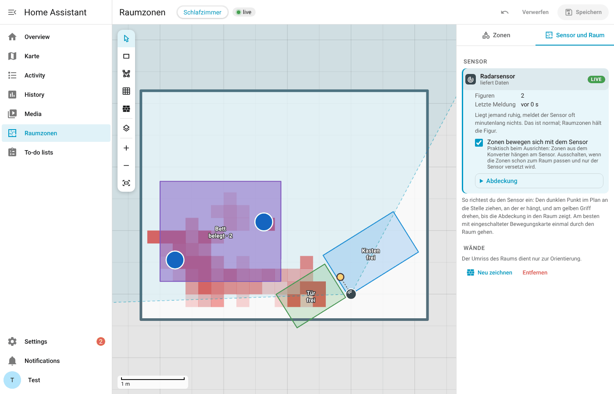
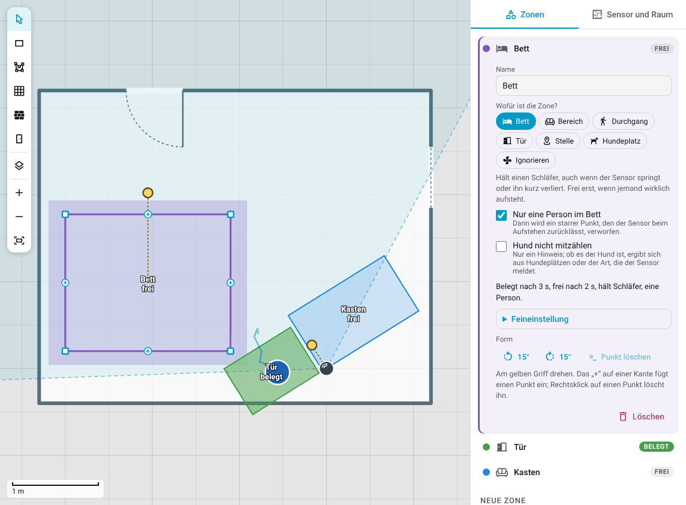
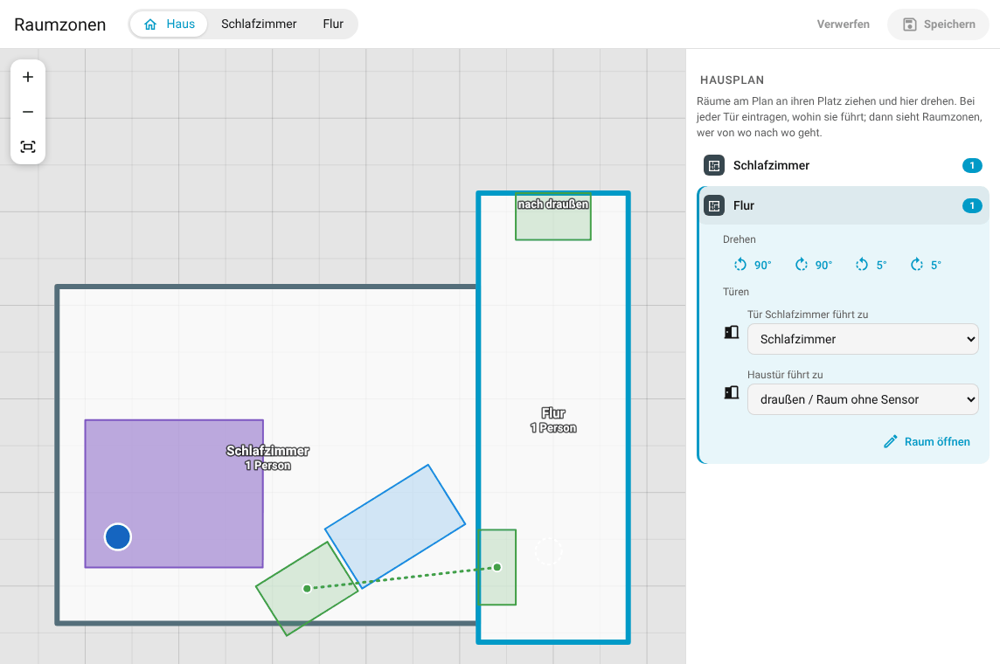

# Raumzonen: Handbuch (Stand 0.6.0)

> Noch nicht mit echter Hardware getestet, nur mit simuliertem Sensor und
> aufgezeichneten Nächten. Die Bilder stammen aus der simulierten
> Test-Instanz (`devtools/testinstanz/`).

## 1. Voraussetzungen im Konverter

* Zigbee2MQTT mit dem erweiterten FP400-Konverter.
* **Mindestens eine Software-Zone im Konverter**, sonst schickt der Konverter
  keine Positionen.
* Für die Quelle „Entitäten“: in Home Assistant die (anfangs deaktivierten)
  Entitäten *Targets xy* und *Tracking last update* des Sensors aktivieren.
  Für „MQTT“ (empfohlen) ist das nicht nötig.

## 2. Einrichten

1. Einstellungen → Geräte & Dienste → Integration hinzufügen → **Raumzonen**
   → bestätigen.
2. Bei Raumzonen auf **Konfigurieren** → **Raum hinzufügen**: Name, das
   FP400-Gerät und die Quelle wählen. Bei MQTT das vorgeschlagene Thema
   prüfen (`zigbee2mqtt/<Name des Sensors in Zigbee2MQTT>`).
3. **Konfigurieren** → **Zonen aus dem Konverter übernehmen**: Für jede
   Software-Zone eine Rolle wählen:
   * **Bett (Schläfer halten)**: bleibt belegt, bis jemand nachweislich
     geht. Vorlage aus den Aufnahmen: belegt nach 3 s, frei nach 2 s,
     Randstreifen 25 cm, höchstens 1 Person.
   * **Ausgang / Tür**: wer hierhin geht, hat den Raum verlassen.
   * **Normale Zone**, **Hundeplatz (Hinweis)**, **Störquelle (ignorieren)**.
4. **Zone einstellen**: alle Wartezeiten und Regeln einer Zone sichtbar
   ändern.

Jede Änderung lädt Raumzonen neu; das dauert einen Moment.

## 3. Das Panel „Raumzonen“

In der Seitenleiste, für **alle Nutzer**: jeder sieht den Plan und die
Live-Punkte. **Ändern dürfen nur Admins**; alle anderen sehen oben „nur
ansehen“, keine Werkzeuge und keinen Speichern-Knopf. Oben stehen die Räume und ob der Sensor gerade Daten liefert
(„live“), rechts Rückgängig, Verwerfen und Speichern. Links der Raumplan mit
den Werkzeugen, rechts die Tabs **Zonen** und **Sensor und Raum**.


### Erst den Sensor ausrichten

Der Raum ist im Plan immer **gerade**. Den Sensor (dunkler Punkt) zieht man
an die Stelle, an der er hängt, und dreht ihn am **gelben Griff**, bis seine
Abdeckung (gestrichelte Fläche) in den Raum zeigt und das Bett gerade liegt.
Der Griff rastet in 5°-Schritten ein (mit Umschalttaste frei).

Solange „**Zonen bewegen sich mit dem Sensor**“ an ist (Tab „Sensor und
Raum“), wandern die Zonen beim Ausrichten mit. Das ist richtig für Zonen,
die aus dem Konverter kommen, denn die hängen am Sensor.

Hilfe dabei: die **Bewegungskarte** (Ebenen-Knopf links). Einmal durch den
Raum gehen; rot wird, wo der Sensor jemanden gesehen hat.



### Stockwerke

Raumzonen übernimmt die Stockwerke aus Home Assistant. Oben im Hausplan
wählst du ein Stockwerk oder „Alle“. Ein Raum liegt auf dem Stockwerk
seines Bereichs; beim Raum im Hausplan lassen sich Bereich und Stockwerke
ändern. Eine **Treppe** kreuzt du auf beiden Stockwerken an: Sie erscheint
dann in beiden Plänen an derselben Stelle und verbindet sie. Räume ohne
Stockwerk stehen nur unter „Alle“ („kein Stockwerk“).

### Grundriss übernehmen

Im Hausplan **Grundriss übernehmen** tippen und den exportierten Plan wählen
(PDF aus dem UniFi Design Center oder ein Bild). Raumzonen zeigt, was es
erkannt hat: nummerierte Räume, grün die Türen, grau die Fenster.

1. **Ein Maß eingeben**: z. B. „Raum 2 ist innen von links nach rechts
   4,20 m“. Der Plan selbst hat keinen Maßstab.
2. Jeden erkannten Raum einem Raum in Raumzonen zuordnen (oder „nicht
   übernehmen“). Räume, die es noch nicht gibt, vorher mit „Raum
   hinzufügen“ anlegen.
3. Lücken prüfen: Tür, offen oder Fenster (Fenster werden weggelassen).
4. **Übernehmen**: Wände, Türen (mit „führt zu“) und die Lage im Haus
   werden gesetzt. Bei Räumen mit Radarsensor danach den Sensor einmessen.

Liegt das Bild nicht genau unter den Räumen: im Hausplan unter
**Grundrisse → Ausrichten** das Bild ziehen, drehen (90°, 5°, 1°) und an
den runden Ecken zuschneiden, dann „Speichern“. Enthält ein PDF mehrere
Grundrisse (einer je Seite), zeigt das Panel sie nebeneinander; du wählst
einen und übernimmst den anderen danach genauso. Unter „Ausrichten“ ordnest du
jeden Grundriss einem **Stockwerk** zu; er erscheint dann nur, wenn oben
dieses Stockwerk gewählt ist (unter „Alle“ nur Grundrisse ohne Stockwerk).

Liegt ein Raum im Hausplan schräg, zeigt ihn auch die Raumansicht so, wie er
im Haus liegt; der Grundriss im Hintergrund ist dann gerade. Der Knopf links
in der Werkzeugleiste (Pfeile im Kreis) schaltet auf „Raum gerade“ und
zurück. Das ist nur die Ansicht; Zonen und Sensor bleiben, wo sie sind.

**Türen verbinden:** Eine Tür in der Wand bekommt im Raum (Werkzeug „Tür /
Öffnung“, dann die Tür in der Liste antippen) einen **Namen** und unter
**„Führt zu“** die Tür auf der anderen Seite. Zeichnest du eine Tür neben
einer Tür des Nachbarraums, verbindet Raumzonen die beiden gleich. Im
Hausplan steht bei jeder Tür ohne Ziel ein Vorschlag („Nächste Tür: …“);
„Türen automatisch verbinden“ übernimmt alle Vorschläge auf einmal. Danach
„Speichern“. Eine Verbindung gilt immer in beide Richtungen.

**Sensor einmessen am Handy:** Unter „Sensor und Raum“ → **„Aufs Handy
schicken“**: Raumzonen schickt eine Nachricht in die Home-Assistant-App;
Antippen öffnet den Assistenten mit großem Plan. Bei mehreren Handys erst
das Handy wählen. (Am Handy kann man den Raum auch direkt öffnen: auf
schmalen Bildschirmen kommt die Handy-Ansicht von selbst.)
„Sensor hängt schon: einmessen“, dann für jede der drei Stellen: einen
Kreis im Plan antippen (A, B, … sind Ecken und Plätze vor den Türen; die
hervorgehobenen liegen weit auseinander), hinstellen, „Messen“, 8 Sekunden
ruhig stehen. Am Ende „Übernehmen“ und „Speichern“.

**Anwesenheit im ganzen Raum:** Jeder Raum mit Wänden hat in Home Assistant
die Anzeige „<Raum> Anwesenheit“ (belegt, solange jemand im Raum ist, frei
5 Sekunden nach dem Letzten). Dafür braucht es keine eigene Zone; in der
Zonen-Liste steht sie oben als „Anwesenheit · ganzer Raum, von selbst“.

**Karte fürs Dashboard:** Dashboard bearbeiten → „Karte hinzufügen“ →
„Raumzonen“ (oder „Manuell“ mit dem Text unten). Die Karte zeigt live, wo
die Zonen liegen und ob sie belegt sind, und wer gerade wo ist; sie ändert
nichts.

```yaml
type: custom:raumzonen-karte
raum: haus          # oder ein Raum, z. B. wohnzimmer
stockwerk: erdgeschoss   # optional, nur beim Hausplan
titel: Erdgeschoss       # optional
hintergrund: true        # Grundriss zeigen
figuren: true            # Personen zeigen
hoehe: 320               # Höhe in Pixel
```

**Wege durchs Haus:** Damit Raumzonen sieht, wer von wo nach wo geht,
braucht jede Tür (1) eine Verbindung zur Tür gegenüber (siehe oben) und (2)
in Radar-Räumen eine **Tür-Zone**: im Raum unter „Zonen“ auf **„Tür-Zonen
anlegen“** tippen, prüfen, „Speichern“. Wird erst die Tür-Zone in einem Raum
und kurz danach (bis 10 s) die verbundene Tür-Zone im Nachbarraum belegt, ist
das ein Weg. Auf der Seite eines Melder-Raums zählt dessen „jemand da“
(ungenauer). Die letzten Wege stehen im Hausplan unter **„Wege“**; für
Automationen gibt es das Ereignis `raumzonen_weg` mit `von`, `nach`, `tuer`
und `genau`.

**Reichweite der Melder:** Bei einem platzierten Melder steht unter
„Melder und Raum“ die **Reichweite laut Plan**, also wie weit der
entfernteste Punkt des Raums vom Melder liegt. Hat der Melder eine
einstellbare Reichweite (z. B. „Maximum range“ bei kleinen Radar-Meldern),
stell sie am Gerät etwa so groß plus 20 cm ein; dann sieht er nicht durch die
Wand ins Nachbarzimmer. „Jemand da“ endet 2 s nach dem letzten Melder; dazu
kommt die Nachlaufzeit, die am Melder selbst eingestellt ist.

**Melder-Raum mit FP400 umwandeln:** Hast du einen Raum mit den
Belegt-Anzeigen eines FP400 als Melder angelegt, steht unter „Melder und
Raum“ der Knopf **„In Radar-Raum umwandeln“**. Wände, Türen, Lage im Haus,
Zonen und „Anwesenheit“ bleiben. Danach unter „Zonen“ **„Aus dem Konverter
übernehmen“** (holt die Zonen der Zonen-Karte) und den Sensor im Plan an
seinen Platz ziehen und drehen. Der Konverter in Zigbee2MQTT bleibt nötig:
Raumzonen liest von ihm die Positionen. Nur seine Software-Zonen und die
Zonen-Karte braucht es danach nicht mehr.

**Zellen-Zone ändern:** Zone in der Liste öffnen, „Zellen bearbeiten“, dann
leere Zellen antippen (dazu) oder volle (weg), zum Schluss „Fertig“. Stimmt die Größe nicht,
dort mit „1 %“/„10 %“ größer oder kleiner machen, oder „Maß neu setzen“:
zwei Punkte einer bekannten Strecke im Bild antippen (z. B. die Enden
einer Wand), die echte Länge in Metern eingeben, „Maß übernehmen“.

Das Bild wird in deinem Home Assistant gespeichert (nicht im Recorder) und
liegt dann im Hausplan und beim Zeichnen im Raum im Hintergrund; ein- und
ausblenden mit dem Bild-Knopf links. Ein Bild ohne erkannte Räume (z. B.
eine Skizze als PNG) lässt sich als Hintergrund übernehmen: zweimal ins
Bild tippen, Länge der Strecke eingeben.

**Öffnungen anpassen:** Öffnung antippen, dann die runden Griffe an den
Enden ziehen (Breite) oder die Öffnung selbst ziehen (verschieben).
**Maße:** Lineal-Knopf links blendet die Länge jeder Wand ein.

### Sensor umsetzen oder einmessen

Unter **Sensor und Raum → Sensor umsetzen** (nur Admins):

* **Vor dem Umhängen starten:** allein im Raum auf drei Stellen stellen
  (mindestens 1 m auseinander, ein Dreieck, z. B. Bettkante, Tür, Fenster)
  und jeweils „Merken“ tippen; 8 Sekunden ruhig stehen. Dann den Sensor
  umhängen, „Sensor hängt neu“ tippen und dieselben Stellen in derselben
  Reihenfolge wieder aufsuchen (im Plan als 1, 2, 3 markiert).
* **Sensor hängt schon: einmessen:** an eine Stelle stellen, „Messen“
  tippen, dann im Plan antippen, wo du standest. Dreimal.

Raumzonen zeigt die neue Lage als grünen Punkt und sagt, wie genau sie ist
(z. B. „± 6 cm“). „Übernehmen“ trägt sie ein, „Speichern“ behält sie. Die
Zonen bleiben, wo sie im Raum sind.

### Räume anlegen, auch nur mit Bewegungsmeldern

Im Hausplan (oben **Haus**) unter **Raum hinzufügen** (nur Admins):

* **Aus Home Assistant übernehmen:** Bereiche, in denen Bewegungs- oder
  Präsenzmelder hängen, stehen als Vorschlag da. Ein Klick legt den Raum mit
  diesen Meldern an.
* **Selbst anlegen:** Name, Art (Bewegungsmelder oder Radarsensor FP400),
  Bereich, dann Melder oder Gerät wählen. Unter jedem Melder steht seine
  Art (Radar, Bewegungsmelder, Kamera, Tablet …), Hersteller und Modell.
  Ist ein Bereich gewählt, zeigt die Liste nur dessen Melder; „Nur Melder
  aus …“ abschalten zeigt alle.

Ein **Melder-Raum** zeigt „jemand da“ oder „niemand“ für den ganzen Raum.
Unter „Melder und Raum“ lässt sich jeder Melder **im Plan platzieren**
(ziehen, am Griff drehen; nur zur Anzeige). Mit **„Zone für diesen
Melder“** zeichnest du den Bereich, den dieser Melder meldet, z. B. eine
Zone eines Aqara FP2; jede Zone bekommt eine eigene Belegt-Anzeige. In Home Assistant entsteht je Raum „Anwesenheit“. Unter
„Melder und Raum“ lassen sich Melder hinzufügen oder entfernen und ein
**Nachlauf** einstellen (so lange bleibt der Raum belegt, nachdem alle
Melder „aus“ melden). Wände und Türen zeichnet man wie bei jedem Raum; im
Hausplan stellt man bei jeder Tür ein, wohin sie führt. Beim
platzierten Melder wählst du die **Erfassung**: „Rundum (Decke)“ für
Melder, die ringsum sehen, oder „Gerichtet (Wand)“ mit der Öffnung (60° bis
150°); dazu die Reichweite in Metern.

**Bewegungsprofil** (unten im Hausplan): für jeden Raum, wann dort jemand
war, und die letzten Wechsel von Raum zu Raum. Welche Person es war, weiß
Raumzonen noch nicht; das ist der nächste Schritt.

Ein Raum lässt sich unter „Sensor und Raum“ bzw. „Melder und Raum“ ganz
unten **löschen** (mit Rückfrage). Seine Anzeigen in Home Assistant
verschwinden dann; Automationen, die sie benutzen, gehen nicht mehr.

### Auswertung: wer war wann wo

**Vorschläge für Zonen:** Wo sich jemand lange aufhielt und noch keine Zone
ist, steht ein Vorschlag mit Größe und Dauer. „Als Zone anlegen“ legt ein
Rechteck an; Rolle wählen, Form anpassen, speichern.


Reiter **Auswertung** (nur für Admins). Oben den Zeitraum wählen: die
letzten 1, 3, 8, 12 oder 24 Stunden. Gerechnet wird aus der eigenen
Aufnahme des Raums (Tab „Sensor und Raum“ → Aufnahme), darum fehlt auch nach
einem Neustart nichts.

* **Karte:** weiche Flecken in 5-cm-Auflösung, je dunkler, desto länger war
  dort jemand. So sieht man z. B., wo genau im Bett jemand lag.
* **Zonen:** wie lange dort jemand war, welche Figuren, und eine Zeitleiste.
* **Figuren:** jede Spur vom Auftauchen bis zum Verschwinden, mit Dauer, von
  bis, Zonen und Zeitleiste. „Hund?“ heißt: als Hund erkannt. Eine Figur
  antippen zeigt nur sie auf der Karte; noch einmal antippen zeigt wieder
  alle.

Welche Person eine Figur ist, weiß Raumzonen noch nicht. Wer aufsteht und
wiederkommt, kann eine neue Nummer bekommen.

### Zonen zeichnen

| Werkzeug (links) | So geht's |
|---|---|
| Auswählen | Zone anklicken und ziehen; Ecken ziehen; Doppelklick auf eine Kante fügt eine Ecke ein, Alt+Klick löscht sie; leere Fläche ziehen verschiebt die Ansicht |
| Rechteck | von Ecke zu Ecke ziehen |
| Vieleck | Ecken anklicken; Klick auf die erste Ecke oder „Fertig“ schließt |
| Zellen | 25-cm-Zellen malen; auf einer bemalten Zelle beginnen radiert |
| Wände | Umriss des Raums, nur zur Orientierung |
| Ebenen | Figuren, Spuren, Abdeckung, Rohpunkte, Bewegungskarte |

Punkte rasten auf 5 cm ein. Rückgängig auch mit Strg+Z, Löschen mit Entf.

Ist eine Zone gewählt:

* **„+“** in der Mitte einer Kante fügt dort einen Punkt ein (gleich
  weiterziehen),
* **Rechtsklick** auf einen Punkt löscht ihn (oder Punkt anklicken und
  „Punkt löschen“),
* am **gelben Griff** dreht man die Zone (5°-Schritte, mit Umschalttaste
  frei), oder mit den Knöpfen 15°.

Dasselbe gilt für die Ecken der Wände, wenn keine Zone gewählt ist.

**Türen und Öffnungen in Wänden:** Werkzeug „Tür / Öffnung“ (auch im Tab
„Sensor und Raum“ unter Wände), dann an der Wand entlang ziehen. Im Tab
lässt sich zwischen **Tür** und **offen** umschalten; bei einer Tür dreht
**„Anschlag wechseln“** das Scharnier auf die andere Seite und **„Nach
außen aufgehen“** die Richtung. Das ist nur die
Zeichnung; damit Raumzonen „betreten“/„verlassen“ erkennt, braucht es
zusätzlich eine Zone mit der Rolle **Tür**.



### Was die Zone tun soll

Eine Zone in der Liste anklicken; sie klappt auf:


* **Wofür ist die Zone?** Bett, Bereich, Durchgang, Tür, Stelle,
  Hundeplatz oder Ignorieren. Jede Rolle bringt passende Regeln mit und erklärt sich in
  einem Satz.
* **Durchgang**: ein Gang oder der Platz vor dem Schrank, wo man nur
  durchgeht. Belegt sofort, frei kurz danach.
* **Stelle**: ein Platz zum Beobachten, z. B. Sessel, Ofen oder Futternapf.
  Sie zeigt, ob dort jemand ist; daraus lernt Raumzonen später (Phase 4b).
* Bei der Tür: **Wohin führt die Tür?** „nach draußen / Raum ohne Sensor“
  oder ein anderer Raum. So weiß Raumzonen, wer von wo nach wo geht. „weiß
  nicht“ ist erlaubt.
* Beim Bett: „Nur eine Person im Bett“ und „Hund nicht mitzählen“.
* Darunter stehen die Wartezeiten als Satz, z. B. „Belegt nach 3 s, frei
  nach 2 s, hält Schläfer, eine Person.“ Unter **Feineinstellung** lassen
  sie sich ändern. Versteckte Wartezeiten gibt es nicht.

**Aus dem Konverter übernehmen** holt die Software-Zonen, die schon im
Zigbee2MQTT-Konverter gezeichnet sind („Bett“ wird Bett, „Tür“ wird Tür).

Nichts wird gespeichert, bis du **Speichern** drückst. Dann prüft Raumzonen
alles noch einmal und lädt neu; die Live-Ansicht kommt von selbst wieder.

### Aufnahme

Im Tab „Sensor und Raum“ unten: **Bewegungen aufzeichnen** (Standard: an,
30 Tage). Raumzonen speichert dann die Punkte des Sensors lokal in Home
Assistant, nicht im Recorder, gepackt etwa 100 kB je Raum und Tag. Ältere
Tage löscht es selbst. Abrufen können sie nur Admins; sie verlassen das
Haus nicht. Wer das nicht möchte, schaltet es je Raum aus und speichert.

Am Handy liegen die Werkzeuge oben quer und die Liste unter dem Plan:


### Hausplan

Oben links **Haus** zeigt alle Räume zusammen, mit den Live-Punkten. Wer
Admin ist, kann:

* einen Raum am Plan an seinen Platz **ziehen** (rastet auf 10 cm ein),
* ihn in der Liste rechts **drehen** (90° oder 5°),
* bei jeder **Tür** eintragen, wohin sie führt: in einen anderen Raum oder
  „draußen / Raum ohne Sensor“. Verbundene Türen zeigt eine Linie.

Dann **Speichern**. Daraus erkennt Raumzonen später, wer von wo nach wo
geht. Räume ohne gezeichnete Wände haben einen gestrichelten Rahmen.



## 4. Was entsteht

Je Raum ein Gerät mit:

| Entität | Bedeutung |
|---|---|
| `binary_sensor.<raum>_<zone>` | Zone belegt (Belegung). Attribute: `personen`, `grund` (`betreten`, `verlassen`, `ausgang`), `geaendert`, `art` |
| `sensor.<raum>_<zone>_personen` | wie viele Figuren in der Zone zählen |
| `binary_sensor.<raum>_sensor_verbunden` | Daten kommen an (Diagnose); Attribut `problem` |
| `sensor.<raum>_figuren` | Figuren im ganzen Raum, auch gehaltene (Diagnose) |

Dazu das Ereignis **`raumzonen_zone`** bei jeder Änderung mit `raum_id`,
`raum`, `zone_id`, `zone`, `belegt` (true/false) und `grund`.

Nach einem Neustart von Home Assistant bleibt ein belegtes Bett belegt, bis
der Sensor etwas anderes zeigt (ein ruhig Liegender wird oft minutenlang
nicht gemeldet).

Fällt der Sensor aus, bleiben alle Zonen, wie sie sind; nur „Sensor
verbunden“ geht aus.

Für andere Integrationen (z. B. das Homebrain) gibt es zusätzlich die
Schnittstelle `raumzonen/1` mit Positionen und Spuren; beschrieben in
`docs/homebrain/VERTRAG-raumzonen-1.md`.

## 5. Beispiel: Licht nach dem Aufstehen

Raumzonen schaltet selbst nichts. Eine eigene Automation, z. B.:

```yaml
triggers:
  - trigger: state
    entity_id: binary_sensor.schlafzimmer_bett
    from: "on"
    to: "off"
conditions:
  - condition: state
    entity_id: sun.sun
    state: below_horizon
actions:
  - action: light.turn_on
    target:
      entity_id: light.flur
    data:
      brightness_pct: 20
```

Die Namen hier sind Beispiele; bitte die eigenen Entitäten wählen.
