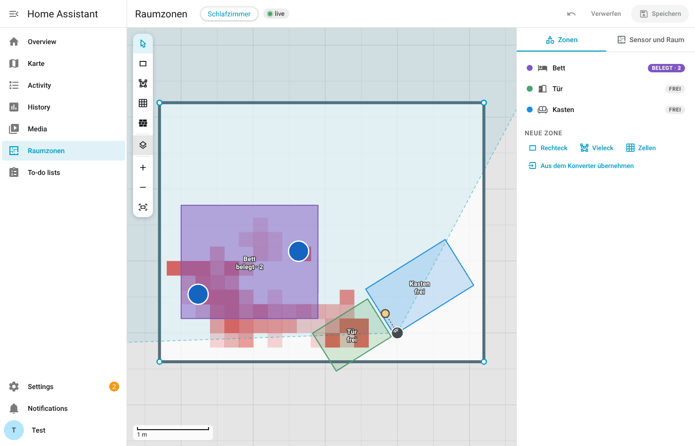
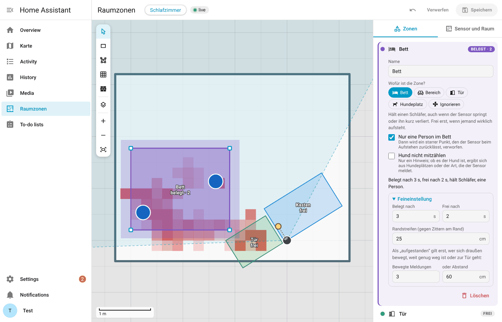
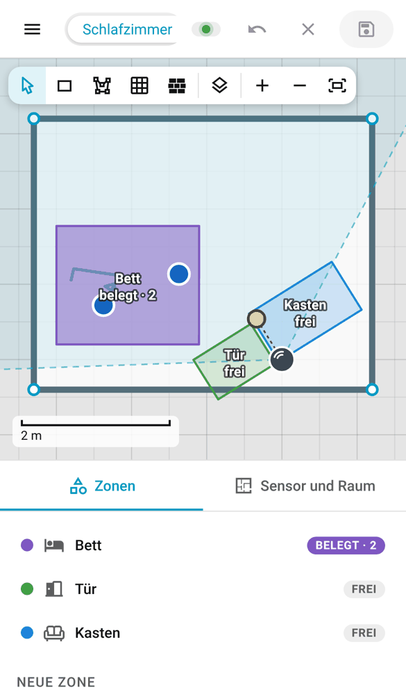

# Raumzonen: Handbuch (Stand 0.6.0)

> Noch nicht mit echter Hardware getestet, nur mit simuliertem Sensor und
> aufgezeichneten Nächten. Die Bilder stammen aus der simulierten
> Test-Instanz (`devtools/testinstanz/`).

## 1. Voraussetzungen im Konverter

* Zigbee2MQTT mit dem erweiterten FP400-Konverter.
* **Mindestens eine Software-Zone im Konverter**, sonst schickt der Konverter
  keine Positionen.
* Für die Quelle „Entitäten“: in Home Assistant die (anfangs deaktivierten)
  Entitäten *Targets xy* und *Tracking last update* des Sensors aktivieren.
  Für „MQTT“ (empfohlen) ist das nicht nötig.

## 2. Einrichten

1. Einstellungen → Geräte & Dienste → Integration hinzufügen → **Raumzonen**
   → bestätigen.
2. Bei Raumzonen auf **Konfigurieren** → **Raum hinzufügen**: Name, das
   FP400-Gerät und die Quelle wählen. Bei MQTT das vorgeschlagene Thema
   prüfen (`zigbee2mqtt/<Name des Sensors in Zigbee2MQTT>`).
3. **Konfigurieren** → **Zonen aus dem Konverter übernehmen**: Für jede
   Software-Zone eine Rolle wählen:
   * **Bett (Schläfer halten)**: bleibt belegt, bis jemand nachweislich
     geht. Vorlage aus den Aufnahmen: belegt nach 3 s, frei nach 2 s,
     Randstreifen 25 cm, höchstens 1 Person.
   * **Ausgang / Tür**: wer hierhin geht, hat den Raum verlassen.
   * **Normale Zone**, **Hundeplatz (Hinweis)**, **Störquelle (ignorieren)**.
4. **Zone einstellen**: alle Wartezeiten und Regeln einer Zone sichtbar
   ändern.

Jede Änderung lädt Raumzonen neu; das dauert einen Moment.

## 3. Das Panel „Raumzonen“

In der Seitenleiste, für **alle Nutzer**: jeder sieht den Plan und die
Live-Punkte. **Ändern dürfen nur Admins**; alle anderen sehen oben „nur
ansehen“, keine Werkzeuge und keinen Speichern-Knopf. Oben stehen die Räume und ob der Sensor gerade Daten liefert
(„live“), rechts Rückgängig, Verwerfen und Speichern. Links der Raumplan mit
den Werkzeugen, rechts die Tabs **Zonen** und **Sensor und Raum**.



### Erst den Sensor ausrichten

Der Raum ist im Plan immer **gerade**. Den Sensor (dunkler Punkt) zieht man
an die Stelle, an der er hängt, und dreht ihn am **gelben Griff**, bis seine
Abdeckung (gestrichelte Fläche) in den Raum zeigt und das Bett gerade liegt.
Der Griff rastet in 5°-Schritten ein (mit Umschalttaste frei).

Solange „**Zonen bewegen sich mit dem Sensor**“ an ist (Tab „Sensor und
Raum“), wandern die Zonen beim Ausrichten mit. Das ist richtig für Zonen,
die aus dem Konverter kommen, denn die hängen am Sensor.

Hilfe dabei: die **Bewegungskarte** (Ebenen-Knopf links). Einmal durch den
Raum gehen; rot wird, wo der Sensor jemanden gesehen hat.


### Zonen zeichnen

| Werkzeug (links) | So geht's |
|---|---|
| Auswählen | Zone anklicken und ziehen; Ecken ziehen; Doppelklick auf eine Kante fügt eine Ecke ein, Alt+Klick löscht sie; leere Fläche ziehen verschiebt die Ansicht |
| Rechteck | von Ecke zu Ecke ziehen |
| Vieleck | Ecken anklicken; Klick auf die erste Ecke oder „Fertig“ schließt |
| Zellen | 25-cm-Zellen malen; auf einer bemalten Zelle beginnen radiert |
| Wände | Umriss des Raums, nur zur Orientierung |
| Ebenen | Figuren, Spuren, Abdeckung, Rohpunkte, Bewegungskarte |

Punkte rasten auf 5 cm ein. Rückgängig auch mit Strg+Z, Löschen mit Entf.

Ist eine Zone gewählt:

* **„+“** in der Mitte einer Kante fügt dort einen Punkt ein (gleich
  weiterziehen),
* **Rechtsklick** auf einen Punkt löscht ihn (oder Punkt anklicken und
  „Punkt löschen“),
* am **gelben Griff** dreht man die Zone (5°-Schritte, mit Umschalttaste
  frei), oder mit den Knöpfen 15°.

Dasselbe gilt für die Ecken der Wände, wenn keine Zone gewählt ist.

**Türen und Öffnungen in Wänden:** Werkzeug „Tür / Öffnung“ (auch im Tab
„Sensor und Raum“ unter Wände), dann an der Wand entlang ziehen. Im Tab
lässt sich zwischen **Tür** und **offen** umschalten. Das ist nur die
Zeichnung; damit Raumzonen „betreten“/„verlassen“ erkennt, braucht es
zusätzlich eine Zone mit der Rolle **Tür**.


### Was die Zone tun soll

Eine Zone in der Liste anklicken; sie klappt auf:



* **Wofür ist die Zone?** Bett, Bereich, Durchgang, Tür, Stelle,
  Hundeplatz oder Ignorieren. Jede Rolle bringt passende Regeln mit und erklärt sich in
  einem Satz.
* **Durchgang**: ein Gang oder der Platz vor dem Schrank, wo man nur
  durchgeht. Belegt sofort, frei kurz danach.
* **Stelle**: ein Platz zum Beobachten, z. B. Sessel, Ofen oder Futternapf.
  Sie zeigt, ob dort jemand ist; daraus lernt Raumzonen später (Phase 4b).
* Bei der Tür: **Wohin führt die Tür?** „nach draußen / Raum ohne Sensor“
  oder ein anderer Raum. So weiß Raumzonen, wer von wo nach wo geht. „weiß
  nicht“ ist erlaubt.
* Beim Bett: „Nur eine Person im Bett“ und „Hund nicht mitzählen“.
* Darunter stehen die Wartezeiten als Satz, z. B. „Belegt nach 3 s, frei
  nach 2 s, hält Schläfer, eine Person.“ Unter **Feineinstellung** lassen
  sie sich ändern. Versteckte Wartezeiten gibt es nicht.

**Aus dem Konverter übernehmen** holt die Software-Zonen, die schon im
Zigbee2MQTT-Konverter gezeichnet sind („Bett“ wird Bett, „Tür“ wird Tür).

Nichts wird gespeichert, bis du **Speichern** drückst. Dann prüft Raumzonen
alles noch einmal und lädt neu; die Live-Ansicht kommt von selbst wieder.

### Aufnahme

Im Tab „Sensor und Raum“ unten: **Bewegungen aufzeichnen** (Standard: an,
30 Tage). Raumzonen speichert dann die Punkte des Sensors lokal in Home
Assistant, nicht im Recorder, gepackt etwa 100 kB je Raum und Tag. Ältere
Tage löscht es selbst. Abrufen können sie nur Admins; sie verlassen das
Haus nicht. Wer das nicht möchte, schaltet es je Raum aus und speichert.

Am Handy liegen die Werkzeuge oben quer und die Liste unter dem Plan:



### Hausplan

Oben links **Haus** zeigt alle Räume zusammen, mit den Live-Punkten. Wer
Admin ist, kann:

* einen Raum am Plan an seinen Platz **ziehen** (rastet auf 10 cm ein),
* ihn in der Liste rechts **drehen** (90° oder 5°),
* bei jeder **Tür** eintragen, wohin sie führt: in einen anderen Raum oder
  „draußen / Raum ohne Sensor“. Verbundene Türen zeigt eine Linie.

Dann **Speichern**. Daraus erkennt Raumzonen später, wer von wo nach wo
geht. Räume ohne gezeichnete Wände haben einen gestrichelten Rahmen.


## 4. Was entsteht

Je Raum ein Gerät mit:

| Entität | Bedeutung |
|---|---|
| `binary_sensor.<raum>_<zone>` | Zone belegt (Belegung). Attribute: `personen`, `grund` (`betreten`, `verlassen`, `ausgang`), `geaendert`, `art` |
| `sensor.<raum>_<zone>_personen` | wie viele Figuren in der Zone zählen |
| `binary_sensor.<raum>_sensor_verbunden` | Daten kommen an (Diagnose); Attribut `problem` |
| `sensor.<raum>_figuren` | Figuren im ganzen Raum, auch gehaltene (Diagnose) |

Dazu das Ereignis **`raumzonen_zone`** bei jeder Änderung mit `raum_id`,
`raum`, `zone_id`, `zone`, `belegt` (true/false) und `grund`.

Nach einem Neustart von Home Assistant bleibt ein belegtes Bett belegt, bis
der Sensor etwas anderes zeigt (ein ruhig Liegender wird oft minutenlang
nicht gemeldet).

Fällt der Sensor aus, bleiben alle Zonen, wie sie sind; nur „Sensor
verbunden“ geht aus.

Für andere Integrationen (z. B. das Homebrain) gibt es zusätzlich die
Schnittstelle `raumzonen/1` mit Positionen und Spuren; beschrieben in
`docs/homebrain/VERTRAG-raumzonen-1.md`.

## 5. Beispiel: Licht nach dem Aufstehen

Raumzonen schaltet selbst nichts. Eine eigene Automation, z. B.:

```yaml
triggers:
  - trigger: state
    entity_id: binary_sensor.schlafzimmer_bett
    from: "on"
    to: "off"
conditions:
  - condition: state
    entity_id: sun.sun
    state: below_horizon
actions:
  - action: light.turn_on
    target:
      entity_id: light.flur
    data:
      brightness_pct: 20
```

Die Namen hier sind Beispiele; bitte die eigenen Entitäten wählen.
